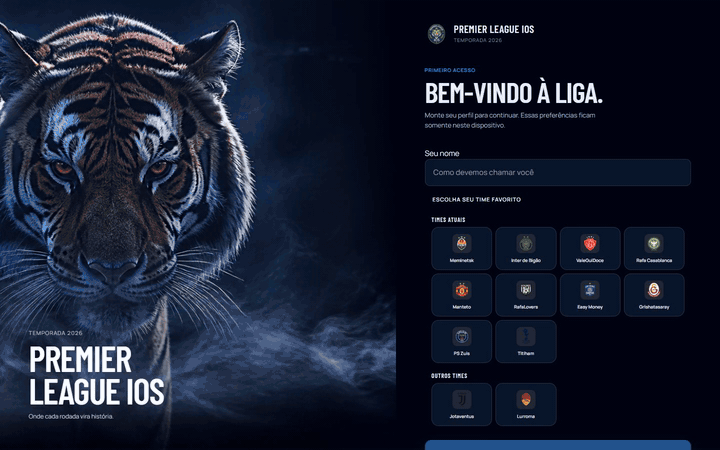
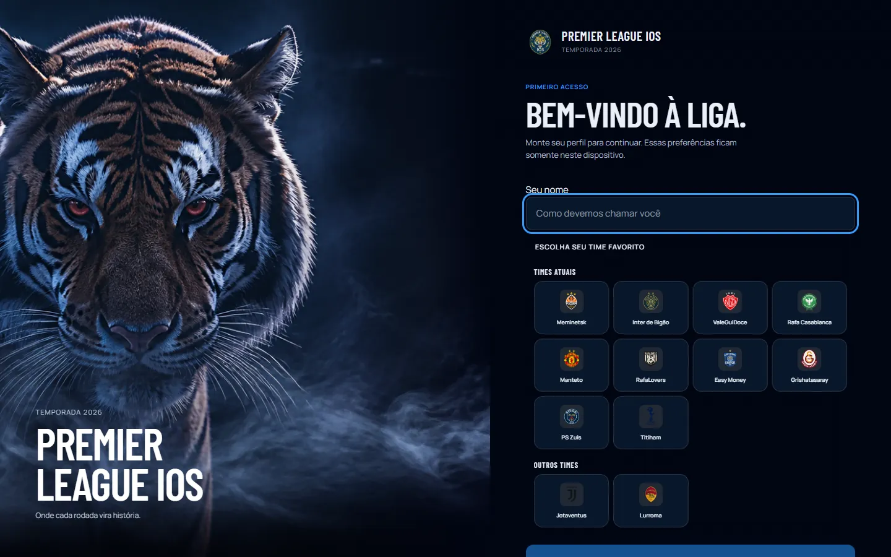
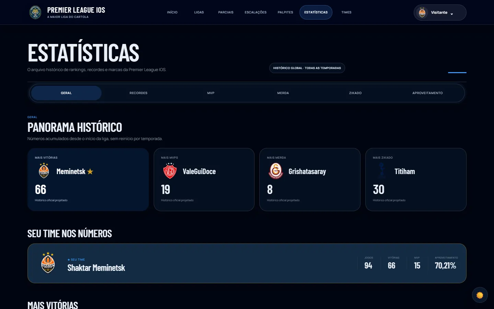
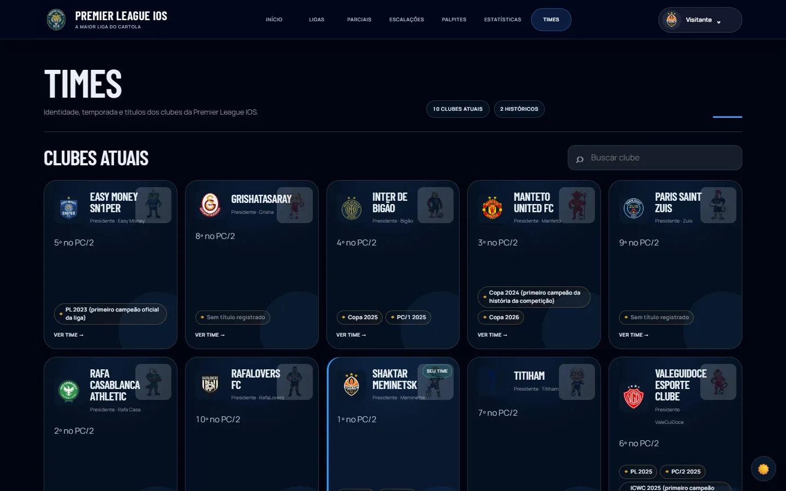
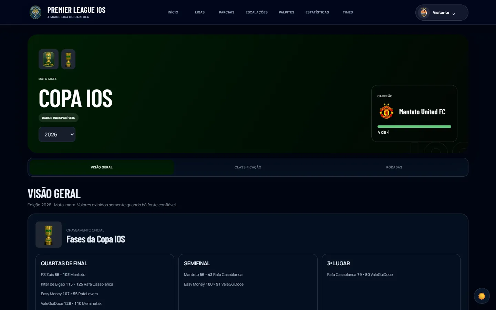
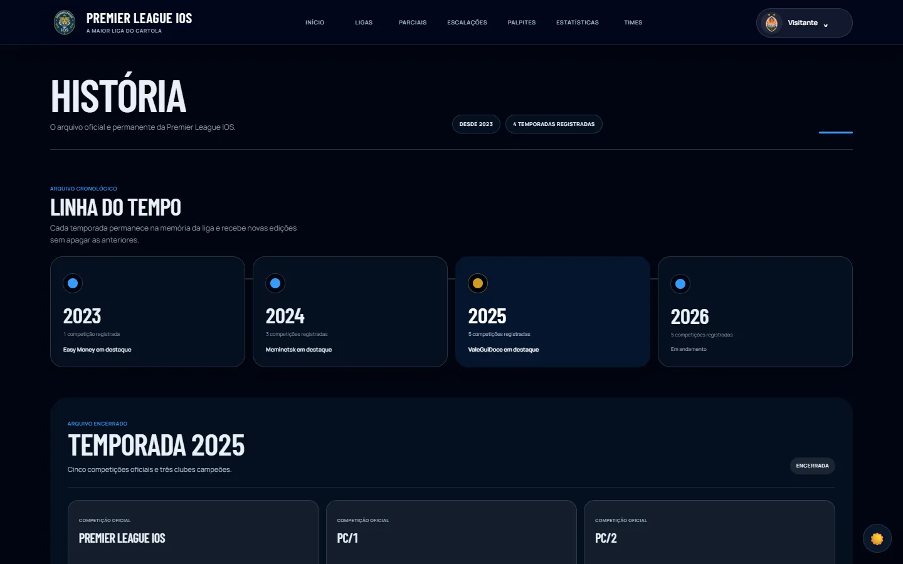
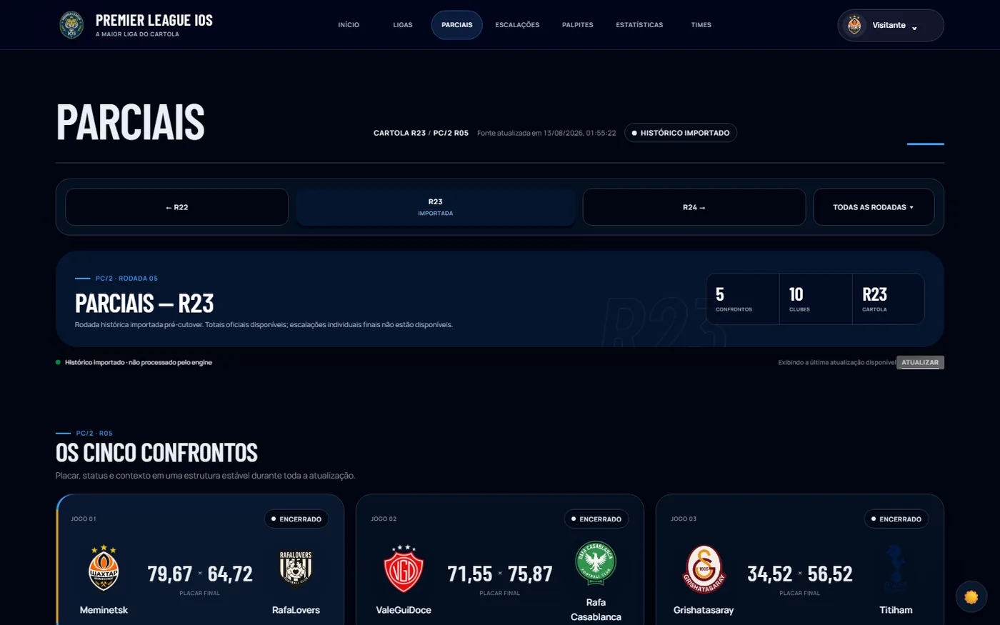
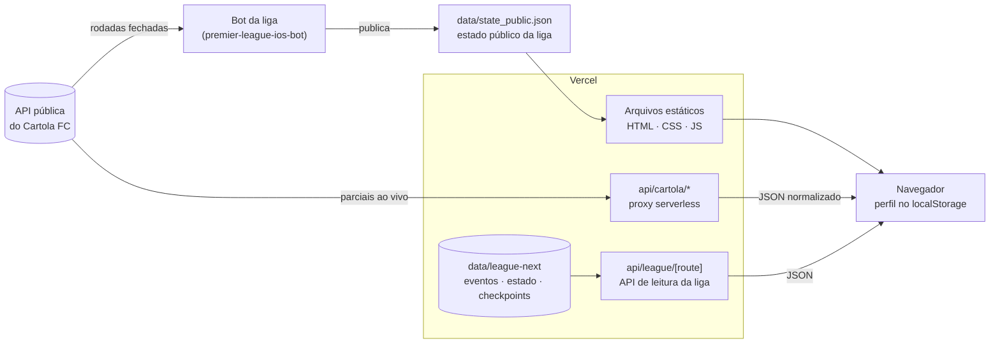

<div align="center">


# Premier League IOS

**O site oficial de uma liga de amigos no Cartola FC: cada rodada vira placar ao vivo, estatística e história.**




**[▶ Vídeo da navegação em boa qualidade (MP4)](docs/navegacao.mp4)**

</div>

---

## O que é

A **Premier League IOS** é uma liga privada de dez amigos dentro do Cartola FC. Além da classificação do próprio Cartola, a liga tem competições internas: pontos corridos em turno e returno (PC/1 e PC/2), a Copa IOS em mata-mata, um Mundial e prêmios por rodada (MVP, "Merda da Rodada" e o contador de "Zikado").

Este repositório é o **site** da liga: um site multipágina, sem framework, que mostra parciais ao vivo, escalações, palpites, estatísticas históricas, a página de cada time e o arquivo de todas as temporadas desde 2023. Ele consome o estado público publicado pelo bot da liga e consulta o Cartola por funções serverless na Vercel, de modo que o navegador nunca conversa direto com a API do Cartola.

> Projeto irmão: **`premier-league-ios-bot`**, o bot que processa as rodadas e publica o `state_public.json` que este site consome.

## Galeria

| Primeiro acesso | Estatísticas |
| :---: | :---: |
|  |  |
| **Times** | **Copa IOS** |
|  |  |
| **História** | **Parciais da rodada** |
|  |  |

## Páginas e recursos

| Página | Arquivo | O que mostra |
| --- | --- | --- |
| Início | `home-page.html` | Destaques da rodada, placar efetivo dos confrontos, último MVP e o time favorito do torcedor |
| Ligas / Temporada | `temporada-2026.html` | Todas as competições da temporada, campeões e status de cada uma |
| Parciais | `rodadas.html` | Confrontos da rodada com parciais ao vivo, navegação entre rodadas e histórico importado |
| Escalações | `escalacoes.html` | Escalação de cada time em campo, capitão e reserva de luxo |
| Palpites | `palpites.html` | Formulário de palpites da rodada com contagem regressiva até o fechamento do mercado |
| Estatísticas | `estatisticas.html` | Panorama histórico, recordes, MVP, Merda, Zikado e aproveitamento |
| Times | `times.html` / `clube.html` | Os dez clubes atuais e os históricos, com escudo, mascote, presidente e títulos |
| Competição | `competicao.html`, `copa-ios.html`, `confronto.html` | Classificação, rodadas e chaveamento de cada competição e detalhe de cada confronto |
| História | `historia.html` | Linha do tempo das temporadas desde 2023 e campeões de cada edição |

Outros recursos:

- **Perfil do torcedor salvo no aparelho.** No primeiro acesso o visitante escolhe um nome e um time favorito. Tudo fica no `localStorage` (`plios.preferences.v1`), sem conta, sem login e sem servidor; o site então destaca esse time em todas as páginas.
- **Tema claro e escuro**, com a escolha persistida no aparelho e respeito a `prefers-reduced-motion`.
- **Navegação rápida** entre páginas, com pré-carregamento dos links.
- **Regras próprias da liga em código testado:** MVP e Merda da rodada, contador de Zikado (o MVP zera, os demais somam 1), pontuação de palpites (até 40 pontos por rodada) e mapeamento entre a rodada do Cartola e a rodada de cada competição.

## Destaques técnicos

- **Sem framework e sem build.** HTML, CSS e JavaScript com ES Modules, servidos como arquivos estáticos. Zero dependências no `package.json`.
- **Funções serverless na Vercel** (`api/`):
  - `api/cartola/*`: `snapshot`, `athlete-scores`, `lineup`, `team` e `classic-league` funcionam como um proxy controlado para a API pública do Cartola, com timeout, normalização dos dados e cabeçalhos de cache (`s-maxage` / `stale-while-revalidate`).
  - `api/league/[route]`: uma API de leitura da liga com rotas permitidas por lista (`status`, `state`, `standings`, `rounds`, `lineups`, `ownership`, `impact`, `live`, `records`, `clubs`, `history`, `health`). Ela lê os dados de um *provider* trocável: arquivo local ou um repositório no GitHub.
- **Motor da liga em JavaScript puro** (`lib/league/`): classificação, confrontos, rodadas, recordes, títulos, prêmios e validação, sem depender de HTTP, sistema de arquivos ou Discord. Por isso dá para testar tudo de forma isolada.
- **Dados versionados com contrato.** Esquemas JSON em `data/schemas/`, um registro de eventos (`events/*.jsonl`), checkpoints, transações com hash e verificação de integridade em `server/league-next/`.
- **Cabeçalhos de segurança** em todas as rotas, definidos no `vercel.json`: `X-Content-Type-Options: nosniff`, `Referrer-Policy: strict-origin-when-cross-origin`, `X-Frame-Options: SAMEORIGIN` e `Permissions-Policy` bloqueando câmera, microfone e geolocalização.
- **Verificação antes do deploy.** `npm run check` confere a sintaxe de todo o JavaScript e garante que o código do navegador não chama a API do Cartola direto, não guarda token do Cartola e não usa proxy CORS público. `npm test` roda a suíte de regressão offline, e um smoke test opcional valida um deploy de preview.
- **Segredos fora do código.** Credenciais só por variáveis de ambiente do lado do servidor; os logs do transporte do GitHub mascaram tokens.

## Arquitetura



- **Dados consolidados:** o bot processa cada rodada fechada e publica `state_public.json`. O site lê esse arquivo e o catálogo de clubes (`data/catalog/`).
- **Dados ao vivo:** durante a rodada, o navegador chama `api/cartola/*`, que consulta o Cartola no servidor e devolve só o necessário.
- **Histórico e regras:** `api/league/[route]` expõe o estado calculado pelo motor (`lib/league`) a partir de `data/league-next`.

## Como rodar localmente

Pré-requisito: **Node.js 22 ou mais recente** (o código usa *import attributes* para JSON). Não há dependências para instalar.

```bash
git clone https://github.com/<seu-usuario>/premier-league-ios-site.git
cd premier-league-ios-site

# Servidor estático simples (sem as funções serverless)
npm start
# abra http://127.0.0.1:4173
```

O site abre com os **dados de exemplo** do repositório (`data/state_public.json`, `data/catalog/clubs.json` e os módulos em `assets/js/data/`). As páginas históricas e estatísticas funcionam por completo. As parciais ao vivo precisam das funções serverless; para usá-las, rode com a CLI da Vercel:

```bash
npm i -g vercel
cp .env.example .env.local   # preencha só o que for usar
npm run dev                  # vercel dev
```

### Sobre os dados de exemplo

Os **IDs de times do Cartola deste repositório são fictícios** (`10000001` a `10000010`), e o slug da liga clássica vem da variável `CARTOLA_LEAGUE_SLUG`. Para apontar o site para uma liga real, troque os `team_id` em `data/catalog/clubs.json` (e nos dados derivados) e configure o slug. Com os IDs fictícios, as rotas ao vivo do Cartola não encontram os times, o que é esperado.

## Variáveis de ambiente

Todas são opcionais para rodar localmente. Veja `.env.example`.

| Variável | Uso |
| --- | --- |
| `CARTOLA_LEAGUE_SLUG` | Slug da liga clássica no Cartola (`api/cartola/classic-league`) |
| `LEAGUE_READ_PROVIDER` | `file` (padrão) ou `github` para a API de leitura da liga |
| `LEAGUE_GITHUB_OWNER`, `LEAGUE_GITHUB_REPO`, `LEAGUE_GITHUB_BRANCH`, `LEAGUE_GITHUB_TOKEN`, `LEAGUE_GITHUB_ROOT` | Provider `github` (somente leitura) |
| `LEAGUE_API_ENABLE_SHADOW_DEBUG` | Libera artefatos de observação só para depuração local |
| `GITHUB_TOKEN`, `GITHUB_REPO`, `LEAGUE_OFFICIAL_BRANCH`, `LEAGUE_EXPECTED_MAIN_SHA` | Laboratório de armazenamento (workflow manual) |
| `PREVIEW_URL` | Endereço do deploy de preview para o smoke test |

## Verificação e testes

```bash
npm run check   # sintaxe de todo o JS + regras de segurança do frontend + estado público + smoke do entrypoint
npm test        # suíte de regressão offline (41 verificações)
```

A suíte cobre o motor da liga (classificação, recordes, viradas de rodada), a integridade do registro de eventos e das transações, a API de leitura (com transporte do GitHub simulado), as projeções de estatísticas e escalações e regras do frontend como acessibilidade da Home, tema padrão e nomes públicos. Nenhum teste da suíte acessa a rede.

Opcional, contra um deploy de preview: `PREVIEW_URL=https://<deploy>.vercel.app npm run smoke:preview`.

## Estrutura

```text
.
├── *.html                    # páginas do site (Início, Parciais, Escalações, Palpites, ...)
├── api/
│   ├── cartola/              # funções serverless: proxy da API do Cartola
│   └── league/[route].js     # API de leitura da liga (rotas por lista de permissão)
├── assets/
│   ├── css/  images/  media/ # estilos, escudos, mascotes e troféus
│   └── js/
│       ├── app/              # módulos de cada página, perfil, tema e navegação
│       ├── data/             # dados históricos consolidados
│       └── services/         # acesso ao estado público e às funções serverless
├── lib/league/               # motor da liga em JS puro (classificação, recordes, títulos...)
├── server/                   # cliente do Cartola, API da liga, armazenamento e integridade
├── data/
│   ├── state_public.json     # estado público (formato publicado pelo bot)
│   ├── catalog/              # catálogo de clubes e competições
│   ├── schemas/              # contratos JSON Schema
│   └── league-next/          # eventos, estado da temporada e baseline
├── scripts/                  # verificação, testes e ferramentas de operação
├── test/                     # fixtures e helpers dos testes
├── docs/                     # especificação visual e imagens do README
└── vercel.json               # rotas amigáveis, funções e cabeçalhos de segurança
```

## Licença

Distribuído sob a licença MIT. Veja [`LICENSE`](LICENSE).

Os nomes, escudos e mascotes dos clubes são criações dos membros da liga, feitas por diversão, sem relação com clubes reais. Cartola FC é marca da Globo; este projeto não tem vínculo oficial com ela.
